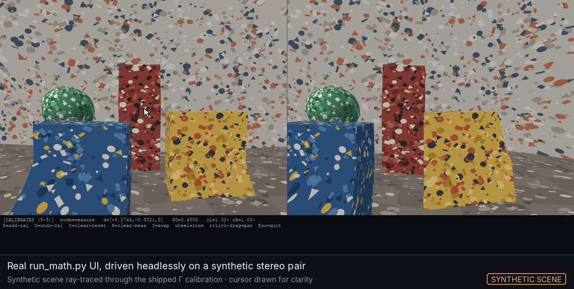
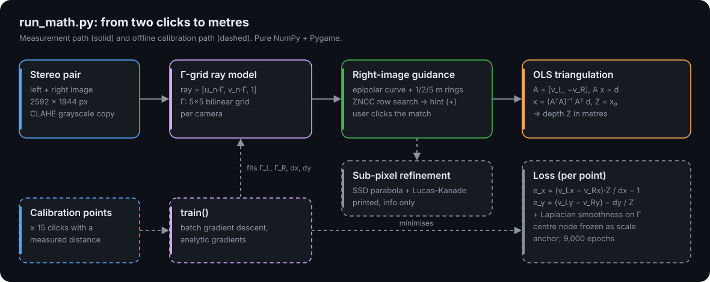
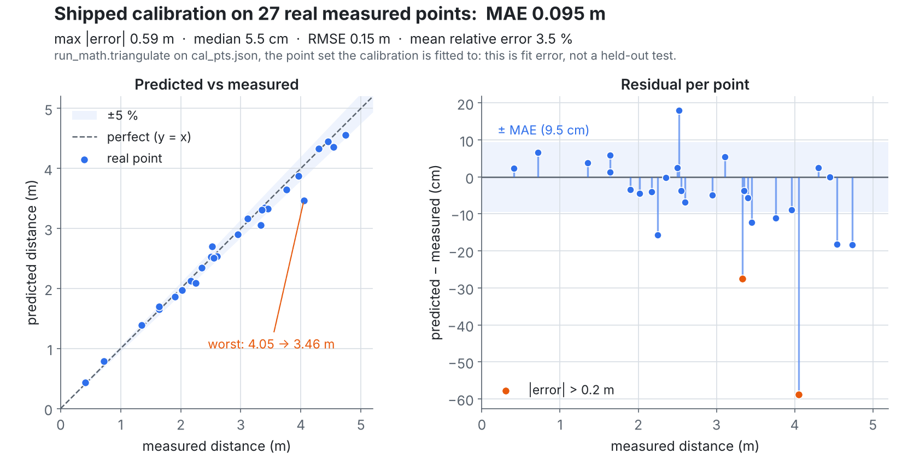
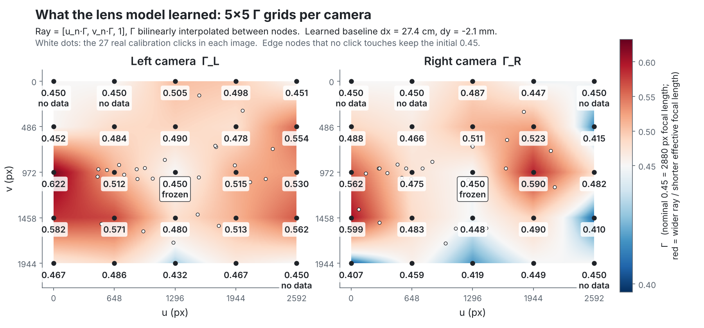
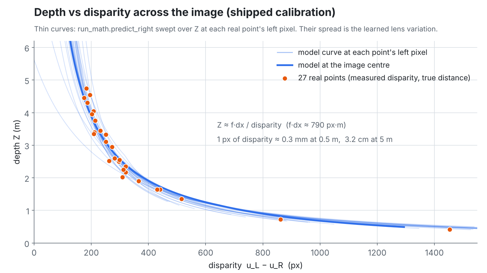
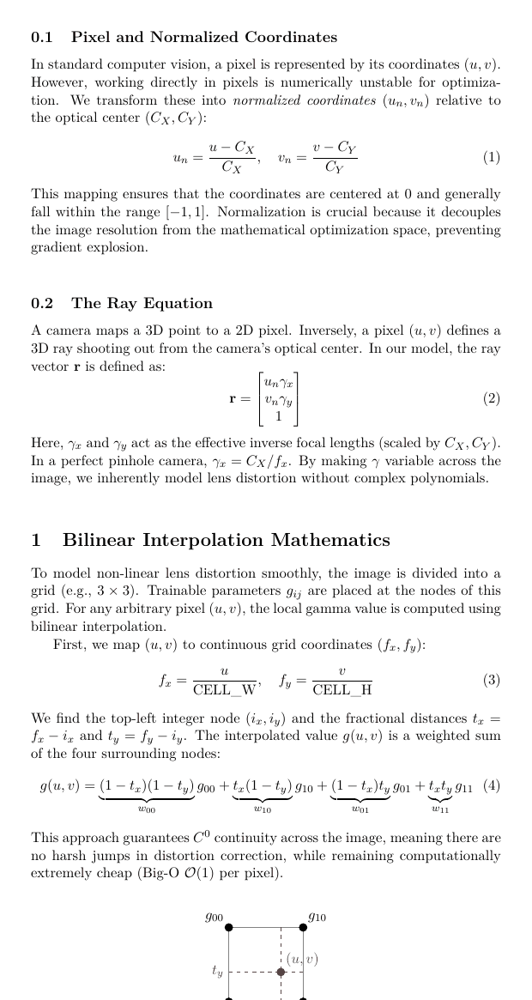
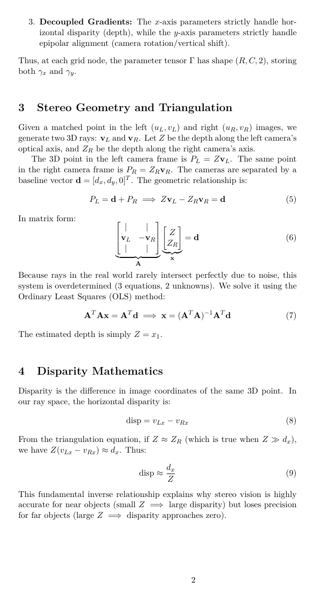
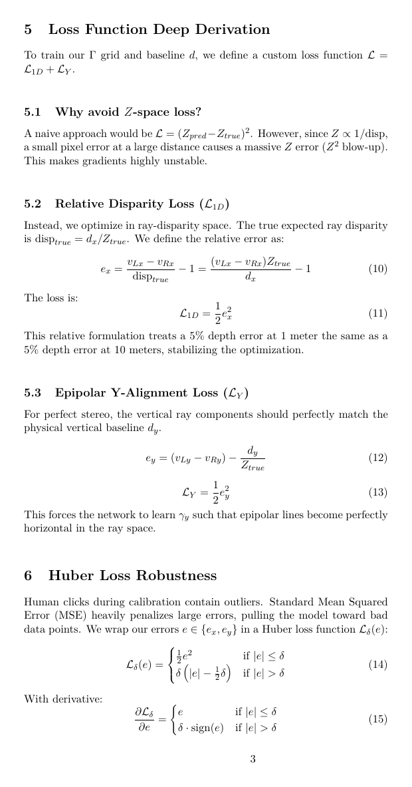

# Stereo Distance Calculator

[](https://github.com/GEV44/stereo-distance-calculator/actions/workflows/ci.yml)
[](LICENSE)

**Pure-NumPy stereo vision system** for measuring real-world distance (meters) from a calibrated pair of cameras. No deep learning, no PyTorch — only analytic geometry, hand-derived gradients, and a lightweight Pygame UI.

Built for a dual-camera rig (2592×1944 px). The full mathematical derivation is in [`docs/MATHEMATICAL_FOUNDATION.pdf`](docs/MATHEMATICAL_FOUNDATION.pdf).

<p align="center">
  
  <br>
  <sub>The real <code>run_math.py</code> UI, driven headlessly by <a href="scripts/make_media.py"><code>scripts/make_media.py</code></a>, on a <b>synthetic scene</b>:
  textured boxes and a wall at known depths, ray-traced through the shipped calibration (the repo contains no real camera photos).
  The bottom bar compares the UI's depth with the scene's ground truth. <a href="docs/media/demo.mp4">MP4 version</a>.</sub>
</p>

---

## Highlights

| Aspect | Detail |
|--------|--------|
| **Model** | Per-camera 5×5 **Γ (gamma) grid** with bilinear interpolation — encodes lens distortion and effective focal length without polynomial distortion models |
| **Optimization** | Analytical gradients + batch **gradient descent** (gradient clipping) + Laplacian smoothness; centre node frozen as scale anchor |
| **Matching** | **ZNCC** search along the clicked row as a visual hint; SSD parabolic sub-pixel and Lucas–Kanade refinement reported for information |
| **Triangulation** | OLS ray intersection: \(x = (A^\top A)^{-1} A^\top d\) |
| **Runtime** | Training (9,000 epochs) in pure Python on CPU, roughly 1–2 min for ~30 points; inference O(1) per click |

---

## How it works (pipeline)

<p align="center">
  
</p>

1. **Normalized coordinates** — \(u_n = (u - C_X)/C_X\), \(v_n = (v - C_Y)/C_Y\) for stable optimization.
2. **Ray** — \(\mathbf{v} = [u_n \gamma_x,\; v_n \gamma_y,\; 1]^\top\) with \(\gamma\) from bilinear interpolation on the grid.
3. **Stereo geometry** — \(Z \mathbf{v}_L - Z_R \mathbf{v}_R = \mathbf{d}\); solved by least squares when rays do not meet exactly.
4. **Loss** — Relative disparity \(e_x = (v_{Lx} - v_{Rx}) / (d_x / Z_{\text{true}}) - 1\) avoids \(Z^2\) gradient blow-up at large distances; epipolar \(e_y\) aligns vertical rays with baseline \(d_y\).

See the PDF for equations, the gradient chain rule, and the function-to-math mapping (`bilinear`, `build_ray`, `triangulate`, `forward_grads`, `train`, etc.). The PDF also derives extensions (Huber loss, Adam, an anchor prior, a local fundamental matrix and quadratic post-correction) that the current `run_math.py` does not implement: it uses a squared loss, plain batch gradient descent and a frozen centre node.

---

## Results

All numbers below come from the data shipped in this repo: the 27 real calibration points in `cal_pts.json` (pixel coordinates in both images plus the measured distance) and the learned `stereo_calibration.json`, evaluated with `run_math.triangulate`.

<p align="center"></p>

On the 27 real points the shipped calibration has a **mean absolute error of 0.095 m** (median 5.5 cm, RMSE 0.15 m, mean relative error 3.5 %). The **worst point is off by 0.59 m** (4.05 m measured, 3.46 m predicted); only two points are off by more than 0.2 m. Read these as fit error, not as held-out accuracy: `cal_pts.json` is the point set that `train()` fits, and the repo has no separate test set. For a held-out estimate, `python scripts/make_media.py loo` retrains from scratch 27 times, each time leaving one point out, and measures the left-out point: **held-out MAE 0.32 m** (median 0.16 m, worst 2.6 m). That is about three times the fit error. With roughly 50 free parameters and 27 points the grids overfit, so more calibration points, especially near the image borders, are the main way to improve accuracy. (Retraining does not reproduce the shipped calibration exactly: a fresh fit on all 27 points lands at dx = 26.1 cm instead of 27.4 cm, with a similar 0.093 m fit MAE.)

<p align="center"></p>

The lens model is two 5×5 grids of Γ, the inverse focal scale, one per camera, bilinearly interpolated between nodes. The centre node is frozen at 0.45 (a 2880 px focal length) to fix the overall scale. The learned values range from about 0.41 to 0.62, so the effective focal length varies by tens of percent across the image. Edge nodes that no calibration click touches stay at their initial 0.45, because the Laplacian smoothness term only acts on interior nodes. More points near the image borders would constrain them.

<p align="center"></p>

Depth is roughly proportional to 1/disparity, with f·dx ≈ 790 px·m for this rig. A one-pixel click error costs about 0.3 mm at 0.5 m but about 3 cm at 5 m, so zooming in with the mouse wheel before clicking the match matters most for far points.

The media are reproducible with `pip install matplotlib && python scripts/make_media.py` (`pdftoppm` and `ffmpeg` are needed for the PDF previews and the video).

---

## Math

The derivation lives in [`docs/MATHEMATICAL_FOUNDATION.pdf`](docs/MATHEMATICAL_FOUNDATION.pdf) (9 pages): normalized coordinates and the ray equation, bilinear Γ interpolation, stereo triangulation by least squares, the disparity relation, the loss and its analytic gradients, plus the extensions noted above that the code does not implement.

<p align="center">
  <a href="docs/MATHEMATICAL_FOUNDATION.pdf"></a>
  <a href="docs/MATHEMATICAL_FOUNDATION.pdf"></a>
  <a href="docs/MATHEMATICAL_FOUNDATION.pdf"></a>
</p>

---

## Repository layout

```
├── run_math.py              # Main app: calibration, matching, measurement UI
├── collect_points.py        # Batch tool to label left/right pairs + distances
├── stereo_calibration.json  # Pre-trained Γ grids + baseline (example)
├── cal_pts.json             # Calibration point cache
├── data/
│   └── sample_training_pairs.json
├── docs/
│   ├── MATHEMATICAL_FOUNDATION.pdf
│   └── media/               # README / portfolio figures and demo video
├── scripts/
│   └── make_media.py        # Regenerates docs/media (plots, PDF previews, demo)
├── left/  right/            # Place stereo image pairs here (for collect_points.py)
├── tests/                   # pytest suite for the math core (no display needed)
├── requirements.txt
└── README.md
```

---

## Requirements

- Python 3.10+
- NumPy, Pygame, OpenCV (for `collect_points.py` only)

```bash
pip install -r requirements.txt
```

---

## Quick start

### 1. Measure distance (interactive)

Place or use any left/right image pair (full resolution 2592×1944 recommended):

```bash
python run_math.py path/to/left.jpg path/to/right.jpg
```

If `stereo_calibration.json` exists, the app loads it and is ready to measure. Otherwise, add **≥ 15 calibration points** (known distance in meters); training runs automatically and saves calibration.

### 2. Collect calibration data (optional)

```bash
# Put matched images in left/ and right/
python collect_points.py
```

Exports `training_data.json` with `(left_pt, right_pt, distance)` entries.

### 3. Run the tests

```bash
pip install pytest
python -m pytest -q
```

The suite runs headless in under a second and runs in CI on every push. It checks that:

- the shipped calibration reproduces the 27 measured distances in `cal_pts.json` (mean error under 0.15 m);
- every analytic gradient in `forward_grads` matches a central finite difference;
- `predict_right` and `triangulate` invert each other;
- the bilinear grid, the Laplacian smoothness term and calibration save/load behave as specified.

---

## Controls (`run_math.py`)

| Key | Action |
|-----|--------|
| **Left click** | Pick point on left, then right |
| **K** | Add calibration point (enter distance, then click L → R) |
| **U** | Undo last calibration point |
| **C** | Clear calibration and reset model |
| **R** | Clear stored measurements |
| **T** | Swap left/right images |
| **Wheel** | Zoom panel under cursor |
| **Right-drag** | Pan |
| **Esc** | Quit |

The right panel shows the **epipolar curve**, **ZNCC hint** (green cross), and depth rings at 1 m / 2 m / 5 m when calibrated.

---

## Technical parameters

| Symbol | Value | Meaning |
|--------|-------|---------|
| \(C_X, C_Y\) | 1296, 972 | Optical center (image center) |
| Grid | 5×5 | Γ nodes per camera (center frozen to \(G_0 = C_X / f_{\text{init}}\)) |
| \(f_{\text{init}}\) | 2880 px | Nominal focal length |
| \(d_x\) min | 0.02 m | Baseline floor |
| Γ clamp | [0.05, 5.0] | Physical focal-scale bounds |
| Smoothness weight | 1e-2 | Laplacian penalty on inner Γ nodes |
| Min cal points | 15 | Before auto-train |

---

## Author

**Gevorg** — [GitHub @GEV44](https://github.com/GEV44)

---

## License

MIT — see [LICENSE](LICENSE).
