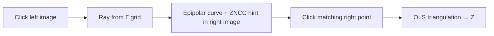

# Stereo Distance Calculator

[](https://github.com/GEV44/stereo-distance-calculator/actions/workflows/ci.yml)
[](LICENSE)

**Pure-NumPy stereo vision system** for measuring real-world distance (meters) from a calibrated pair of cameras. No deep learning, no PyTorch — only analytic geometry, hand-derived gradients, and a lightweight Pygame UI.

Built for a dual-camera rig (2592×1944 px). The full mathematical derivation is in [`docs/MATHEMATICAL_FOUNDATION.pdf`](docs/MATHEMATICAL_FOUNDATION.pdf).

---

## Highlights

| Aspect | Detail |
|--------|--------|
| **Model** | Per-camera 5×5 **Γ (gamma) grid** with bilinear interpolation — encodes lens distortion and effective focal length without polynomial distortion models |
| **Optimization** | Analytical gradients + batch **gradient descent** (gradient clipping) + Laplacian smoothness; centre node frozen as scale anchor |
| **Matching** | **ZNCC** search along the clicked row as a visual hint; SSD parabolic sub-pixel and Lucas–Kanade refinement reported for information |
| **Triangulation** | OLS ray intersection: \(x = (A^\top A)^{-1} A^\top d\) |
| **Runtime** | Training (9,000 epochs) in pure Python on CPU, roughly 1–2 min for ~30 points; inference O(1) per click |

---

## How it works (pipeline)



1. **Normalized coordinates** — \(u_n = (u - C_X)/C_X\), \(v_n = (v - C_Y)/C_Y\) for stable optimization.
2. **Ray** — \(\mathbf{v} = [u_n \gamma_x,\; v_n \gamma_y,\; 1]^\top\) with \(\gamma\) from bilinear interpolation on the grid.
3. **Stereo geometry** — \(Z \mathbf{v}_L - Z_R \mathbf{v}_R = \mathbf{d}\); solved by least squares when rays do not meet exactly.
4. **Loss** — Relative disparity \(e_x = (v_{Lx} - v_{Rx}) / (d_x / Z_{\text{true}}) - 1\) avoids \(Z^2\) gradient blow-up at large distances; epipolar \(e_y\) aligns vertical rays with baseline \(d_y\).

See the PDF for equations, the gradient chain rule, and the function-to-math mapping (`bilinear`, `build_ray`, `triangulate`, `forward_grads`, `train`, etc.). The PDF also derives extensions (Huber loss, Adam, an anchor prior, a local fundamental matrix and quadratic post-correction) that the current `run_math.py` does not implement: it uses a squared loss, plain batch gradient descent and a frozen centre node.

---

## Repository layout

```
├── run_math.py              # Main app: calibration, matching, measurement UI
├── collect_points.py        # Batch tool to label left/right pairs + distances
├── stereo_calibration.json  # Pre-trained Γ grids + baseline (example)
├── cal_pts.json             # Calibration point cache
├── data/
│   └── sample_training_pairs.json
├── docs/
│   └── MATHEMATICAL_FOUNDATION.pdf
├── left/  right/            # Place stereo image pairs here (for collect_points.py)
├── requirements.txt
└── README.md
```

---

## Requirements

- Python 3.10+
- NumPy, Pygame, OpenCV (for `collect_points.py` only)

```bash
pip install -r requirements.txt
```

---

## Quick start

### 1. Measure distance (interactive)

Place or use any left/right image pair (full resolution 2592×1944 recommended):

```bash
python run_math.py path/to/left.jpg path/to/right.jpg
```

If `stereo_calibration.json` exists, the app loads it and is ready to measure. Otherwise, add **≥ 15 calibration points** (known distance in meters); training runs automatically and saves calibration.

### 2. Collect calibration data (optional)

```bash
# Put matched images in left/ and right/
python collect_points.py
```

Exports `training_data.json` with `(left_pt, right_pt, distance)` entries.

---

## Controls (`run_math.py`)

| Key | Action |
|-----|--------|
| **Left click** | Pick point on left, then right |
| **K** | Add calibration point (enter distance, then click L → R) |
| **U** | Undo last calibration point |
| **C** | Clear calibration and reset model |
| **R** | Clear stored measurements |
| **T** | Swap left/right images |
| **Wheel** | Zoom panel under cursor |
| **Right-drag** | Pan |
| **Esc** | Quit |

The right panel shows the **epipolar curve**, **ZNCC hint** (green cross), and depth rings at 1 m / 2 m / 5 m when calibrated.

---

## Technical parameters

| Symbol | Value | Meaning |
|--------|-------|---------|
| \(C_X, C_Y\) | 1296, 972 | Optical center (image center) |
| Grid | 5×5 | Γ nodes per camera (center frozen to \(G_0 = C_X / f_{\text{init}}\)) |
| \(f_{\text{init}}\) | 2880 px | Nominal focal length |
| \(d_x\) min | 0.02 m | Baseline floor |
| Γ clamp | [0.05, 5.0] | Physical focal-scale bounds |
| Smoothness weight | 1e-2 | Laplacian penalty on inner Γ nodes |
| Min cal points | 15 | Before auto-train |

---

## Author

**Gevorg** — [GitHub @GEV44](https://github.com/GEV44)

---

## License

MIT — see [LICENSE](LICENSE).
