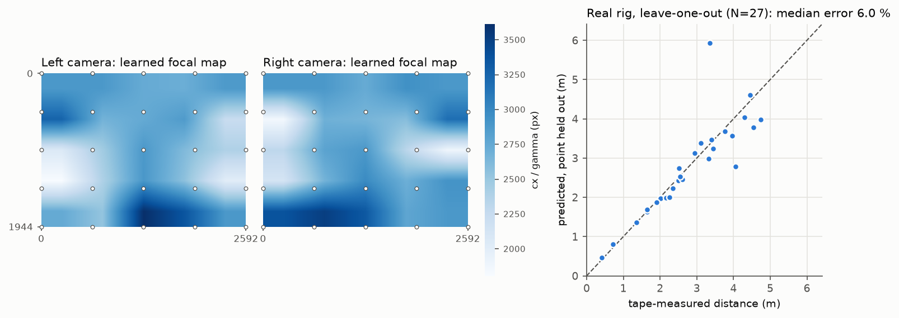
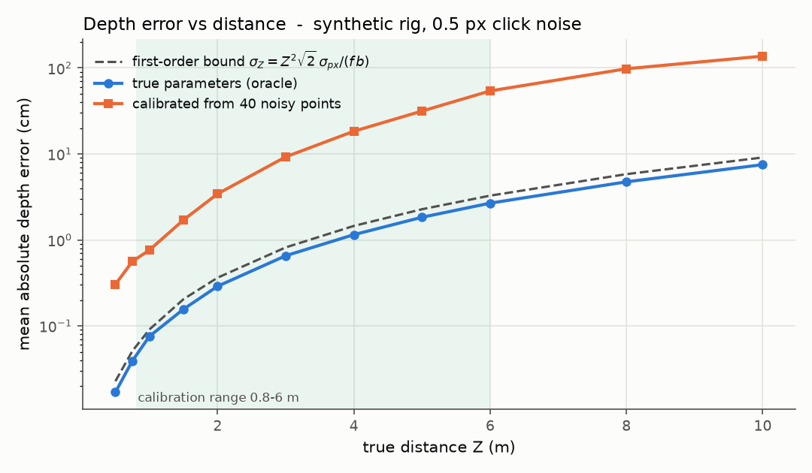
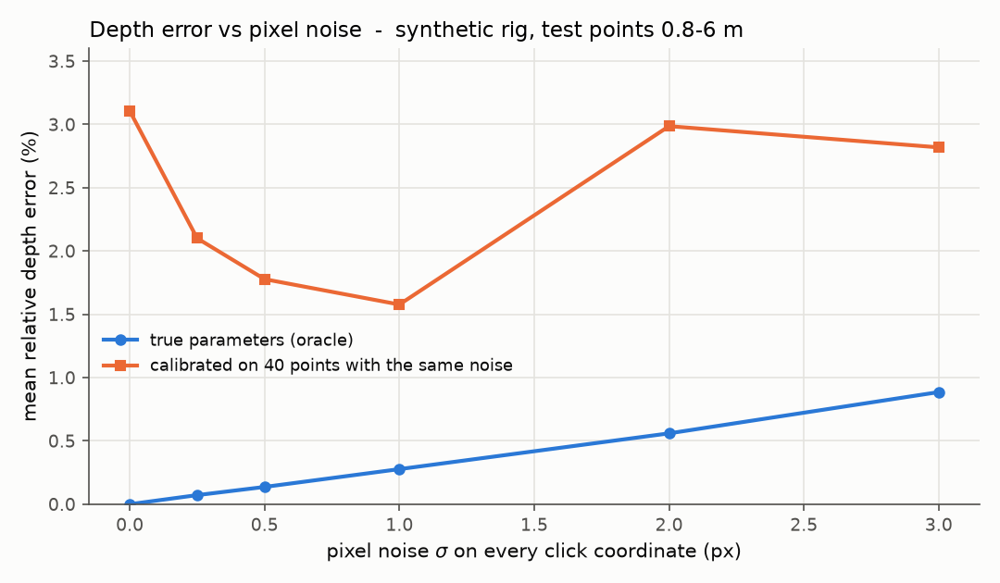

# Stereo Distance Calculator

**Metric distance from two ordinary cameras, built from first principles in pure NumPy: a learned 5×5 lens grid, hand-derived gradients, ZNCC epipolar matching and least-squares triangulation. No OpenCV calibration, no autograd, no deep learning.**

[](https://github.com/GEV44/stereo-distance-calculator/actions/workflows/ci.yml)
[](https://www.python.org/downloads/release/python-3120/)
[](LICENSE)
[](https://github.com/astral-sh/ruff)



*Left and middle: the focal length each camera learned across the frame (cx / Γ, in px, with the 5×5 nodes marked), from 27 hand-labelled points. Right: depth predicted for each real point by a model that never saw it (leave-one-out), against the tape-measured distance.*

---

## At a glance

| | |
|---|---|
| **Problem** | Click a point in the left and right photo and get its distance in metres |
| **Lens model** | One 5×5 grid of Γ nodes per camera, bilinearly interpolated. It encodes focal length and smooth distortion with no polynomial distortion model |
| **Calibration** | 15 or more clicked pairs with tape-measured distances. The loss works in relative disparity, every gradient is derived by hand, and training uses batch gradient descent with Laplacian smoothness. 9000 epochs take a few seconds on a CPU |
| **Matching** | CLAHE, then a 1-D ZNCC search along the epipolar row, then SSD parabola or Lucas–Kanade sub-pixel refinement |
| **Triangulation** | Closed-form OLS ray intersection: $x = (A^\top A)^{-1}A^\top d$ |
| **Accuracy, real rig** | **6.0 % median relative error** (15.8 cm median, 31.9 cm mean) on held-out points, 0.4–4.7 m, leave-one-out |
| **Accuracy, synthetic** | 0.8 cm at 1 m, 3.4 cm at 2 m, 18 cm at 4 m (0.5 px click noise, calibrated from 40 points) |
| **Engineering** | Installable package, typed API, CLI, 76 tests (gradients checked against finite differences), CI on Linux and Windows |

## Why pure NumPy?

The aim was to understand every number in the pipeline, not to call `cv2.stereoCalibrate`.

- **Every derivative is derived and checked.** The loss → ray → Γ-node chain rule is written out in [`docs/MATHEMATICAL_FOUNDATION.pdf`](docs/MATHEMATICAL_FOUNDATION.pdf), implemented in `calibration.forward_grads`, and compared against central finite differences for all 50 grid nodes and the baseline in `tests/test_gradients.py`.
- **The model is small enough to inspect.** There are 48 trainable lens values and a 2-D baseline. You can plot the learned focal map (above), see where it is constrained, and reason about failure modes. Several of those are listed under [Limitations](#limitations--next-steps).
- **It has one runtime dependency.** The core needs only `numpy`. Pygame (interactive UI) and OpenCV (batch labelling tool) are optional extras.
- **It runs fast on a laptop.** Gradient accumulation is vectorised, so a full calibration takes seconds and a depth query takes microseconds.

## Method

### 1. Pixel → ray (pure-gamma lens model)

Pixels are centred and normalised, and the local Γ value is read off the grid:

$$u_n = \frac{u - c_x}{c_x},\quad v_n = \frac{v - c_y}{c_y},\qquad
\mathbf r(u,v) = \begin{bmatrix} u_n\,g \\ v_n\,g \\ 1 \end{bmatrix},\qquad
g = \sum_{k=1}^{4} w_k(u,v)\,\Gamma_k$$

Here $w_k$ are the bilinear weights of the four nodes around the pixel. A uniform grid $g = c_x/f$ is exactly a pinhole camera. Letting nodes differ absorbs radial and asymmetric distortion. The centre node is **frozen** at $G_0 = c_x/f_\text{init}$, which fixes the absolute scale. Without it, focal length and baseline could trade off freely.

### 2. Triangulation (OLS)

For a matched pair, the point lies at depth $Z$ on the left ray and at $Z_R$ on the right ray, offset by the baseline $\mathbf d = [d_x, d_y, 0]^\top$:

$$Z\,\mathbf r_L - Z_R\,\mathbf r_R = \mathbf d
\;\;\Longrightarrow\;\;
A = [\,\mathbf r_L \;|\; -\mathbf r_R\,],\qquad
\begin{bmatrix} Z \\ Z_R \end{bmatrix} = (A^\top A)^{-1}A^\top\mathbf d$$

That is 3 equations in 2 unknowns, so noisy rays that don't quite meet still give the least-squares depth. Degenerate cases (negative disparity, parallel rays, $Z \le 0$) return `nan` plus a reason.

### 3. Calibration loss and analytic gradients

A depth-space loss $(Z_\text{pred} - Z_\text{true})^2$ blows up at long range, because $Z \propto 1/\text{disparity}$. Instead the loss compares disparities **relatively**, so a 5 % error weighs the same at 1 m and at 5 m:

$$e_x = \frac{(r_{Lx} - r_{Rx})\,Z_\text{true}}{d_x} - 1,\qquad
e_y = (r_{Ly} - r_{Ry}) - \frac{d_y}{Z_\text{true}},\qquad
\mathcal L = \tfrac12 e_x^2 + \tfrac12 e_y^2$$

The chain rule gives every gradient in closed form:

$$\frac{\partial \mathcal L}{\partial \Gamma_k^{L}} = \Big(e_x \tfrac{Z_\text{true}}{d_x}\,u_n + e_y\,v_n\Big)\,w_k,\qquad
\frac{\partial \mathcal L}{\partial d_x} = -e_x\,\frac{(r_{Lx}-r_{Rx})\,Z_\text{true}}{d_x^2},\qquad
\frac{\partial \mathcal L}{\partial d_y} = -\frac{e_y}{Z_\text{true}}$$

The right-camera gradients have the opposite sign. Training averages these over all points and adds a Laplacian smoothness term $\lambda\,(4G_{ij} - \sum_\text{4-nbrs} G)$, so the grid bends like an elastic sheet. It then clips the gradient norm, takes a step, clamps $\Gamma \in [0.05, 5]$ and $d_x \ge 2$ cm, and re-pins the centre node. The best epoch is kept. A Huber loss and Adam are available as options (`--huber 0.05`, `--optimizer adam`), following the derivation in the PDF.

### 4. Matching (hint for the user)

Both images get CLAHE once. For a left click, the right image is searched along the same row with **zero-mean normalised cross-correlation**:

$$\text{ZNCC}(A,B) = \frac{\sum_i (A_i-\bar A)(B_i-\bar B)}{\sqrt{\sum_i (A_i-\bar A)^2}\sqrt{\sum_i (B_i-\bar B)^2}} \in [-1, 1]$$

ZNCC ignores brightness offsets and contrast changes between the two cameras. The integer peak can then be refined with an SSD parabola or a 2-D Lucas–Kanade step. In the UI the match is only a hint and the user's own click decides. The calibrated model also draws the exact, distorted epipolar curve by inverting the right Γ grid at depths 0.5–50 m.

The full derivation, with the numerical-stability guards and the mapping from functions to equations, is in **[`docs/MATHEMATICAL_FOUNDATION.pdf`](docs/MATHEMATICAL_FOUNDATION.pdf)**.

## Results

All numbers come from `python benchmarks/synthetic_eval.py` (fixed seeds, default 9000-epoch trainer). Full tables are in [`benchmarks/results.md`](benchmarks/results.md) and raw values in `benchmarks/results.json`.

### Real rig: leave-one-out on the shipped data

The repository contains 27 hand-clicked point pairs from the author's 2592×1944 rig, with tape-measured distances (`cal_pts.json`, 0.41–4.74 m). It does **not** contain the photos themselves. For each point, a model was trained on the other 26 and asked for the held-out distance:

| Metric | Value |
|---|---:|
| Median relative error (held out) | **6.0 %** |
| Median absolute error (held out) | **15.8 cm** |
| Mean relative error (held out) | 10.1 % |
| Mean absolute error (held out) | 31.9 cm |
| Held-out points within 5 % | 11 / 27 |
| Fit on all 27 (training error) | 9.3 cm |
| Shipped `stereo_calibration.json` on the same 27 | 9.5 cm |

These distances come from human clicks and a tape measure, so the error includes clicking error on both images. The mean is pulled up by one point: 3.35 m predicted as 5.94 m. It sits near the right edge of the frame, where the labels disagree: its pixel disparity (209 px) is close to a neighbour's (195 px), but the two were tape-measured at 3.35 m and 4.54 m. The gap between the 9.3 cm training fit and the held-out error shows the model **overfits**: about 50 lens and baseline parameters against 26 points. More calibration points spread across the frame are the most direct fix (see Limitations).

### Synthetic benchmark: error vs distance

This test uses a simulated rig shaped like the real one: f = 2880 px, baseline 0.27 m, about 8 % smooth lens distortion, a 3 mm vertical offset. Every click coordinate gets **0.5 px** Gaussian noise. "Oracle" uses the true lens and baseline. "Calibrated" uses what `train()` learned from 40 noisy calibration points at 0.8–6 m.



| Z (m) | First-order bound (cm) | Oracle MAE (cm) | Calibrated MAE (cm) | Calibrated rel. error |
|---:|---:|---:|---:|---:|
| 0.5 | 0.02 | 0.02 | 0.30 | 0.6 % |
| 0.75 | 0.05 | 0.04 | 0.56 | 0.8 % |
| 1 | 0.09 | 0.08 | 0.76 | 0.8 % |
| 1.5 | 0.20 | 0.16 | 1.71 | 1.1 % |
| 2 | 0.36 | 0.29 | 3.44 | 1.7 % |
| 3 | 0.82 | 0.65 | 9.25 | 3.1 % |
| 4 | 1.45 | 1.15 | 18.37 | 4.6 % |
| 5 | 2.27 | 1.83 | 31.51 | 6.3 % |
| 6 | 3.27 | 2.68 | 54.05 | 9.0 % |
| 8 | 5.82 | 4.74 | 97.84 | 12.2 % |
| 10 | 9.09 | 7.50 | 137.13 | 13.7 % |

With the true parameters, the error follows the textbook $\sigma_Z \approx Z^2\sqrt2\,\sigma_\text{px}/(f\,b)$ curve, which confirms the geometry and triangulation are right. After calibration, error is several times higher and **its relative size grows with distance** (about 0.8 % at 1 m, about 9 % at 6 m). The cause is a small disparity bias left by calibration, not click noise. See Limitations.

### Synthetic benchmark: error vs pixel noise

For each noise level, a fresh calibration is trained on 40 noisy points and tested on 2000 noisy held-out points at 0.8–6 m.



| σ (px) | Oracle rel. error | Calibrated MAE (cm) | Calibrated rel. error | Learned baseline (true 0.27 m) |
|---:|---:|---:|---:|---:|
| 0 | 0.00 % | 9.0 | 3.11 % | 0.287 m |
| 0.25 | 0.07 % | 5.1 | 2.10 % | 0.281 m |
| 0.5 | 0.14 % | 4.9 | 1.78 % | 0.276 m |
| 1 | 0.28 % | 4.6 | 1.58 % | 0.270 m |
| 2 | 0.56 % | 8.1 | 2.99 % | 0.282 m |
| 3 | 0.89 % | 7.8 | 2.82 % | 0.278 m |

Up to 3 px of click noise, the calibrated error stays at **about 1.5–3 %**, with no clear trend. Run-to-run differences between calibrations (which 40 points were drawn) matter more than the noise itself.

## Quick start

```bash
git clone https://github.com/GEV44/stereo-distance-calculator.git
cd stereo-distance-calculator
python -m pip install -e ".[ui]"         # core needs only numpy; [ui] adds pygame
```

**Measure with the shipped calibration (no images needed):**

```bash
python -m stereo_distance info    --calib stereo_calibration.json --points cal_pts.json
python -m stereo_distance measure 2480 1086 2171 1130            # uL vL uR vR -> Z in metres
python -m stereo_distance predict 2480 1086 2.0                  # where should the right click be at 2 m?
```

**Calibrate your own rig:**

```bash
python -m stereo_distance calibrate --points cal_pts.json --out stereo_calibration.json
python -m stereo_distance calibrate --points cal_pts.json --optimizer adam --huber 0.05   # variants
```

**Interactive tool** (2592×1944 images; others are rescaled):

```bash
python -m stereo_distance ui left.jpg right.jpg    # same as: python run_math.py left.jpg right.jpg
```

| Key | Action |
|---|---|
| Left click | Pick a point on the left image, then on the right |
| **K** | Add a calibration point: type the distance, then click left → right. Training runs automatically from 15 points |
| **U** / **C** / **R** | Undo calibration point / reset model / clear measurements |
| **T** | Swap left and right |
| Wheel / right-drag | Zoom / pan |

The right panel shows the distorted epipolar curve, the ZNCC hint (green cross) and the predicted positions at 1 m, 2 m and 5 m.

**Use it as a library:**

```python
from stereo_distance import load_calibration, triangulate_pair

gamma_l, gamma_r, d = load_calibration("stereo_calibration.json")
t = triangulate_pair(2480, 1086, 2171, 1130, gamma_l, gamma_r, d)
print(t.z, t.point, t.error)
```

## Project layout

```
stereo_distance/
├── config.py          RigConfig: sensor size, grid, focal prior, clamps
├── lens.py            bilinear Γ grid, pixel→ray, Laplacian, ray→pixel inversion
├── triangulation.py   OLS ray intersection (scalar + vectorised)
├── calibration.py     relative-disparity loss, analytic gradients, trainer (GD / Adam, Huber)
├── matching.py        CLAHE, ZNCC epipolar search, SSD sub-pixel, Lucas–Kanade
├── synthetic.py       known-geometry stereo rig + textures for tests/benchmarks
├── io.py              calibration & point files (incl. legacy 4×4 grids)
├── cli.py             python -m stereo_distance …
└── ui.py              interactive Pygame tool (optional [ui] extra)
benchmarks/synthetic_eval.py   reproduces every number and figure in this README
tests/                         76 pytest tests
docs/MATHEMATICAL_FOUNDATION.pdf   full derivation
run_math.py, collect_points.py     original entry points (run_math is now a thin wrapper)
stereo_calibration.json, cal_pts.json, data/   shipped calibration + 27 labelled real points
```

## Tests

```bash
python -m pip install -e ".[dev]"
python -m ruff check .
python -m pytest -q          # 76 tests, ~1 min
```

| Area | What is checked |
|---|---|
| Lens | Bilinear weights sum to 1 and hit nodes exactly; a uniform grid is a pinhole; vectorised and scalar code agree; grid inversion is accurate to < 0.05 px |
| Triangulation | Exact round-trip on a pinhole rig; < 1e-4 relative error on a distorted rig; vertical baseline; error grows about as Z²; invalid pairs return `nan` plus a reason |
| Gradients | Every Γ node and the baseline match central finite differences (rtol 1e-5), including the Huber branch; gradient is zero at the ground truth |
| Matching | ZNCC finds a planted 37 px shift under noise and after a brightness/contrast change; SSD and Lucas–Kanade recover fractional shifts |
| Calibration | Recovers the synthetic baseline; a distorted rig ends up better than the pinhole prior; centre node and clamps are respected; Huber resists a mislabelled point; the 27 real points fit to < 12 cm |
| CLI and I/O | `python -m stereo_distance` help/version; full calibrate → measure → predict → info cycle; file round-trips; legacy formats |

CI ([`.github/workflows/ci.yml`](.github/workflows/ci.yml)) runs ruff, pytest, the CLI smoke steps and a quick benchmark on Ubuntu and Windows with Python 3.12.

## Limitations & next steps

Measured limits, not guesses:

- **The baseline is only weakly identified.** Γ and $d_x$ scale disparity in nearly the same way, and only the centre node is pinned. Plain gradient descent therefore approaches the true baseline slowly. On the synthetic rig (true 0.27 m) it learned 0.311 m after 1500 epochs, and 0.270–0.287 m after the default 9000 depending on the calibration set. Pinning more of the focal scale, or adding a second-order step (Gauss–Newton or Levenberg–Marquardt on these same analytic Jacobians), would converge faster.
- **Calibration bias, not click noise, sets the accuracy.** With the true parameters, depth error is millimetres at 1–2 m. With learned parameters it is centimetres, growing faster than Z² (table above). More calibration points that are spread evenly across the frame and across depths reduce this. So would a held-out validation split and early stopping in the trainer.
- **The vertical focal is tied to the horizontal one.** $v_n$ is normalised by $c_y$ while $g$ is shared, so a uniform grid means $f_y = f\,c_y/c_x$. The PDF describes an anisotropic variant with separate $\gamma_x, \gamma_y$ grids. The current code keeps the single-grid model the shipped calibration was trained with.
- **Too few real calibration points for about 50 parameters.** Real-rig error is 9.3 cm on training points but 15.8 cm median and 31.9 cm mean on held-out points. Options: more points covering every grid cell, a smaller grid (3×3) when few points are available, or stronger smoothness or anchor priors.
- **The real-data evaluation is small:** 27 points, no photos in the repository, so the matching stage cannot be scored on real images. Collecting a set of photos with ground truth (for example a laser distance meter) would allow an end-to-end benchmark.
- **The optical centre is fixed at the image centre**, and the cameras are assumed rectified apart from a small $d_y$ (no rotation is modelled). A 3-D rotation between the cameras would be the natural next parameter.
- **Next steps:** uncertainty per measurement from the covariance of $(A^\top A)^{-1}$, multi-scale grids (3×3 → 9×9), and bundle adjustment over the calibration points, as already outlined in the PDF.

## License

MIT, see [LICENSE](LICENSE).

## Author

**Gevorg Hovhannisyan**, Yerevan, Armenia · [GitHub @GEV44](https://github.com/GEV44)

Method, derivation, rig and data by the author. Version 1.0.0 packages the project, adds the test suite and benchmark, and documents the results ([CHANGELOG](CHANGELOG.md)).
